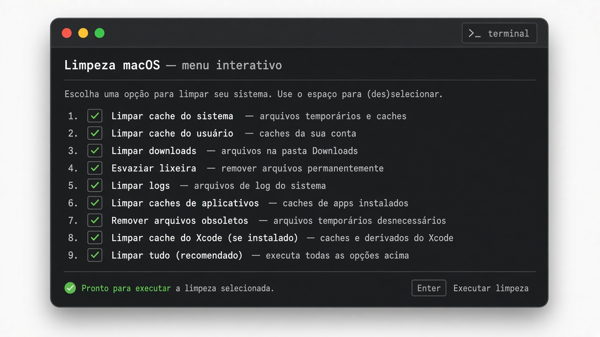
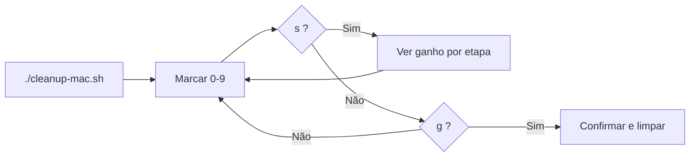

# 🧹 Limpeza macOS (`cleanup-mac.sh`)

Script em **bash** para liberar espaço no Mac sem ferramentas pagas: **lixeira**, **caches**, **logs**, **resíduos de apps**, **Xcode**, **Homebrew**, **Docker** e etapas opcionais com `sudo`.

---

## 🚀 Início rápido

```bash
cd ~/Documents/PROJECTS/GIT/cleanup-mac   # ajuste o caminho
chmod +x cleanup-mac.sh
./cleanup-mac.sh                          # abre o menu interativo
```

| Comando | Descrição |
|---------|-----------|
| `./cleanup-mac.sh` | **Menu interativo** (recomendado) |
| `./cleanup-mac.sh --menu` | Força o menu |
| `./cleanup-mac.sh --classic` | Modo antigo (pergunta a cada etapa, sem menu) |
| `./cleanup-mac.sh --dry-run` | Estimativa resumida (nada é apagado) |
| `./cleanup-mac.sh --dry-run --dry-run-verbose` | Lista cada arquivo candidato |
| `./cleanup-mac.sh --help` | Ajuda completa no terminal |

---

## 🖥️ Menu interativo

Ao rodar **sem flags** no Terminal, o script abre um painel com etapas **0–9**. A tela **limpa e redesenha** a cada escolha; uma linha **`→`** mostra o último feedback (ex.: dry-run ligado/desligado).



### ✅ `[x]` e `[ ]` — o que significam?

| Símbolo | Significado |
|---------|-------------|
| **`[x]`** | Etapa **marcada** — entra na limpeza quando você confirmar com **`g`**. |
| **`[ ]`** | Etapa **desmarcada** — **ignorada** na execução. |

**Não** digite a letra `x`. Você **liga/desliga** pela **tecla numérica** da linha.

### 🔢 Como marcar e desmarcar

No prompt **`Opção:`**, digite o **número** e pressione **Enter**. Cada vez **alterna** `[ ]` ↔ `[x]`:

| Tecla | Etapa |
|-------|--------|
| `1` | Lixeira |
| `2` | Resíduos de apps |
| `3` | + Preferences/Containers *(precisa de `2` marcado)* |
| `4` | Caches `~/Library/Caches` (completo) |
| `5` | Caches seguros *(dev/navegadores — substitui `4`)* |
| `6` | Logs e crash reports antigos |
| `7` | Xcode / Simulador |
| `8` | Homebrew, npm, Docker… |
| `9` | Time Machine local + fontes *(sudo)* |
| `0` | purge RAM *(sudo — não libera disco)* |

**Exemplo:** com `[x]` em **1**, **4** e **6**, só lixeira, caches e logs rodam ao executar.

### ⌨️ Atalhos do menu

| Tecla | Ação |
|-------|------|
| **`p`** | Perfil **rápido** — marca 1, 4 e 6 |
| **`a`** | Perfil **completo** — quase tudo *(sem purge RAM por padrão)* |
| **`d`** | Liga/desliga **dry-run** *(só estimativa ao usar `g`)* |
| **`y`** | Auto-aceitar etapas **seguras** *(arriscadas ainda pedem confirmação)* |
| **`s`** | **Simular** — ganho estimado **por etapa (0–9)** + total do que está `[x]` |
| **`g`** | **Executar** — resumo, estimativa e confirmação |
| **`q`** | Sair sem alterar nada |

### 📊 Simulação (`s`)

- Limpa a tela e lista **todas** as etapas **1–9** e **0** com ganho **se aquela etapa fosse executada**.
- `[x]` / `[ ]` ao lado indica o que está marcado no menu.
- **TOTAL** no fim = soma **apenas** das etapas `[x]` *(regras: não somar 4 e 5 juntos; opção 3 só entra no total se 2 também estiver `[x]`)*
- **Enter** volta ao menu.

### ▶️ Executar (`g`)

1. Valida a seleção (ex.: conflito 4+5).
2. Mostra **resumo** + **ganho estimado**.
3. Etapas arriscadas/sudo podem exigir digitar **`CONFIRMO`**.
4. Confirma com **`s`** / **`sim`** *(ou cancela)*.

---

## 📋 O que cada etapa faz

| # | Nome | Resumo |
|---|------|--------|
| 1 | Lixeira | Esvazia `~/.Trash` |
| 2 | Resíduos de apps | Pastas em `~/Library` sem `.app` correspondente ⚠️ |
| 3 | Resíduos sensíveis | Preferences / Containers ⚠️⚠️ *(com `--orphans-include-sensitive` ou opção 3 no menu)* |
| 4 | Caches completos | Conteúdo de `~/Library/Caches` *(respeita lista de preservação no script)* |
| 5 | Caches seguros | Só subpastas conhecidas (Homebrew, npm, navegadores…) |
| 6 | Logs | Logs com mais de 30 dias + `.ips`/`.crash` antigos |
| 7 | Xcode | DerivedData, cache do simulador, DeviceSupport antigo… |
| 8 | Dev tools | `brew cleanup`, npm/Yarn/pip, Docker opcional |
| 9 | Sudo | Snapshots locais Time Machine + cache de fontes |
| 0 | purge | `sudo purge` — **RAM**, não disco |

⚠️ = revisar antes; pode haver falso positivo (ex.: pastas “Google”, “Adobe”).

---

## 🛠️ Linha de comando (sem menu)

```bash
# Etapas seguras sem perguntar (arriscadas/sudo ainda pedem):
./cleanup-mac.sh --yes

# Tudo sem perguntar (sudo onde o macOS exigir):
./cleanup-mac.sh --full

# Só lixeira + caches + logs:
./cleanup-mac.sh --caches-only

# Caches leves (não esvazia ~/Library/Caches inteiro):
./cleanup-mac.sh --caches-safe

# Pular resíduos de apps:
./cleanup-mac.sh --skip-orphans

# Cron semanal leve:
./cleanup-mac.sh --caches-only --yes
```

---

## 🗂️ Resíduos de apps desinstalados

Compara apps em `/Applications`, `~/Applications` e `/System/Applications` com pastas em `~/Library`.

- Por padrão **não** analisa `Preferences`, `Containers`, `Group Containers` nem `HTTPStorages` — use opção **3** no menu ou `--orphans-include-sensitive`.
- `.app` quebrados (sem `Info.plist`) entram na lista.
- Etapa **arriscada**: confirmação extra (`--yes` **não** pula).
- Whitelist Apple / pastas do sistema (Mail, Shared, etc.).

---

## 🚫 O que **não** faz

- ❌ Não remove apps instalados, documentos ou fotos
- ❌ Não apaga Keychain ou senhas do Safari
- ❌ Não altera `/System` sem etapa explícita com `sudo`

---

## 💾 Limpar `~/Library/Caches`

Remove **só o conteúdo** (a pasta permanece). Efeitos comuns:

| Efeito | Detalhe |
|--------|---------|
| Espaço em disco | Principal ganho em muitos Macs |
| Apps | Primeira abertura pode ficar mais lenta (cache recriado) |
| Navegador | Sites recarregam do zero; **senhas salvas não** são apagadas |
| Ícones | Miniaturas podem regenerar — normal |

---

## 🧠 Memória (RAM) — `purge` (opção `0`)

`sudo purge` descarta cache inativo na **RAM**. **Não libera disco**; o macOS já gerencia memória. Use só se souber que precisa.

---

## 🔗 Atalho no PATH

```bash
mkdir -p ~/bin
ln -sf "$(pwd)/cleanup-mac.sh" ~/bin/cleanup-mac
```

No `~/.zshrc`:

```bash
export PATH="$HOME/bin:$PATH"
```

Depois: `cleanup-mac --dry-run`

---

## ⏰ Agendamento (cron)

```bash
crontab -e
```

Exemplo (domingo 3h — ajuste o caminho):

```cron
0 3 * * 0 /Users/renatoaraujo/Documents/PROJECTS/GIT/cleanup-mac/cleanup-mac.sh --caches-only --yes >> /tmp/cleanup-mac.log 2>&1
```

Antes de automatizar, teste com `--dry-run`.

---

## 💡 Dicas manuais

- **Armazenamento:** Ajustes do Sistema → Geral → Armazenamento
- **Downloads:** revise `~/Downloads`
- **Mail / VMs:** anexos grandes; discos Parallels/VMs

---

## 🔄 Fluxo sugerido (menu)



1. Abra o menu → marque etapas com **números**.
2. **`s`** para simular ganho.
3. **`g`** para executar (ou **`d`** + **`g`** para só estimativa global).
